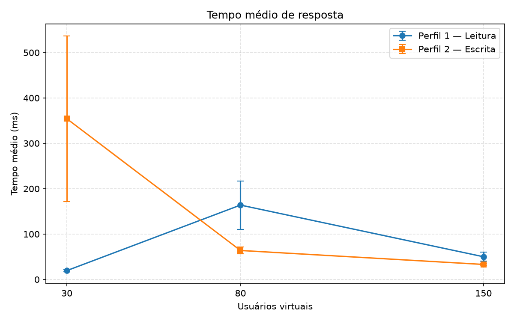
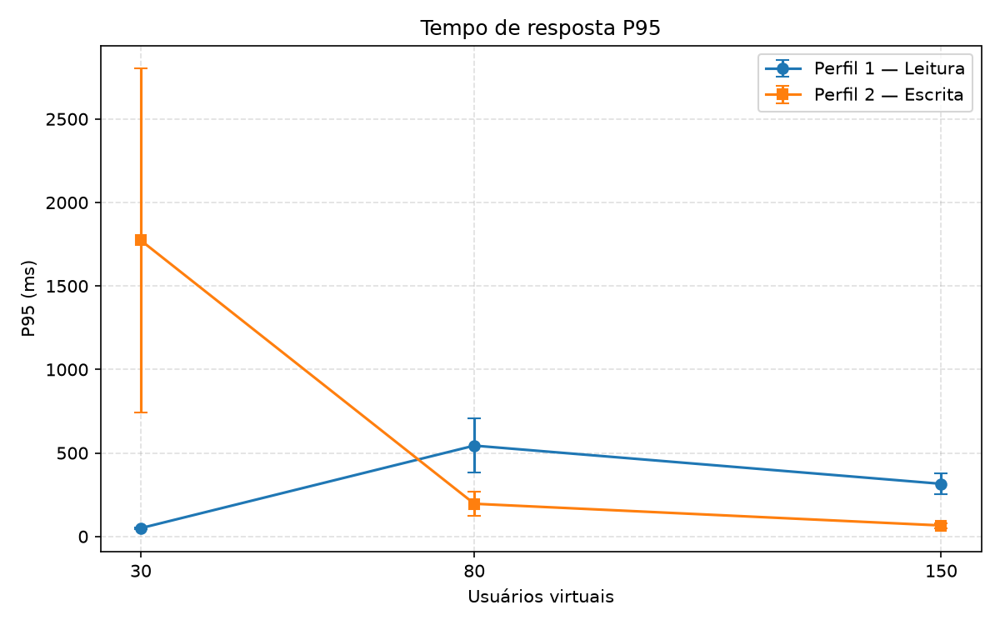
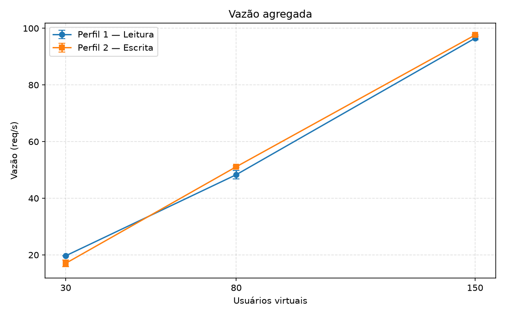
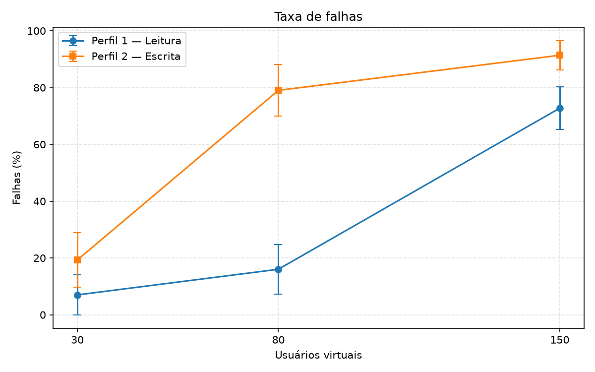
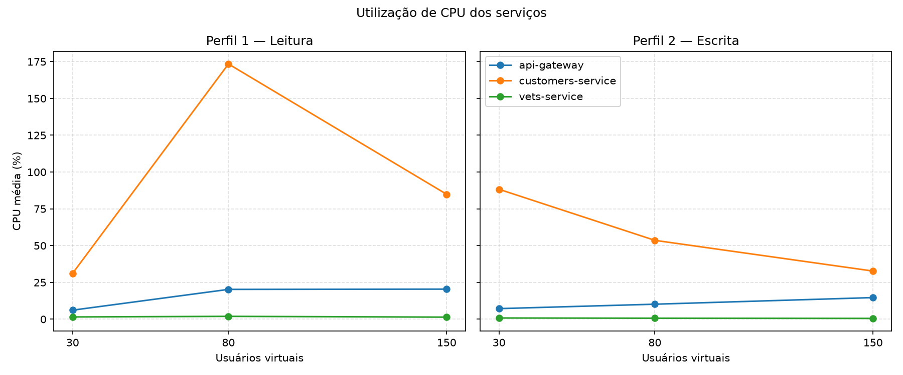
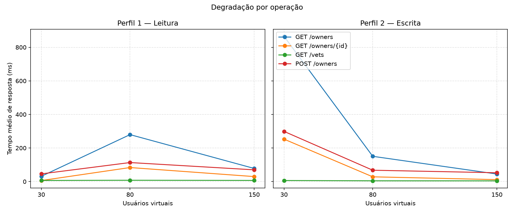

# Trabalho Prático 06 — Avaliação de Desempenho com Locust

Avaliação de desempenho do [Spring PetClinic Microservices](https://github.com/spring-petclinic/spring-petclinic-microservices) usando Locust, Docker Compose e monitoramento de CPU dos serviços.

**Vídeo demonstrativo:**

> Vídeo no youtube: `https://www.youtube.com/watch?v=vYlTprbi6VY`

---

## 1. Como reproduzir

### 1.1 Pré-requisitos

- Docker Desktop (Compose v2+)
- Python 3.11+ (testado com 3.12.10)
- 8 GB de RAM para o Docker (o compose limita cada serviço a 512 MB)

### 1.2 Subir a aplicação

Na raiz do repositório:

```powershell
docker compose up -d
```

Aguarde o Eureka (`http://localhost:8761`) listar `API-GATEWAY`, `CUSTOMERS-SERVICE` e `VETS-SERVICE`. O frontend fica em `http://localhost:8080`.

| Serviço | URL |
|---|---|
| API Gateway / UI | http://localhost:8080 |
| Eureka | http://localhost:8761 |
| Customers | http://localhost:8081 |
| Vets | http://localhost:8083 |
| Grafana | http://localhost:3030 |
| Prometheus | http://localhost:9091 |
| Zipkin | http://localhost:9411 |
| Spring Boot Admin | http://localhost:9090 |

O `genai-service` não é necessário para este trabalho (os testes não chamam o chatbot).

### 1.3 Instalar o Locust

```powershell
python -m pip install -r requirements-loadtest.txt
```

### 1.4 Conferir os endpoints (versão desta aplicação)

O enunciado cita `/owners` e `/vets`. Nesta versão as rotas públicas passam pelo **API Gateway** (Spring Cloud Gateway), que remove o prefixo `/api/{serviço}`:

| Operação do enunciado | Rota real | Serviço destino |
|---|---|---|
| `GET /owners` | `GET /api/customer/owners` | customers-service |
| `GET /owners/{id}` | `GET /api/customer/owners/{id}` | customers-service |
| `GET /vets` | `GET /api/vet/vets` | vets-service |
| `POST /owners` | `POST /api/customer/owners` | customers-service |

O corpo do `POST` segue o record `OwnerRequest`: `firstName`, `lastName`, `address`, `city`, `telephone`.

### 1.5 Interface do Locust (demonstração)

```powershell
python -m locust -f locustfile.py ReadProfile --host http://localhost:8080
```

Abra http://localhost:8089. Para o perfil de escrita, troque `ReadProfile` por `WriteProfile`.

### 1.6 Experimentos completos (60 execuções)

**Campanha desta entrega (para caber no prazo):** 20 s de aquecimento + 90 s de medição, 10 repetições, 2 perfis × 3 cenários = **60 execuções** (~2 h). O enunciado pede 6 min + 1 min; o comando equivalente está mais abaixo.

```powershell
python scripts/run_experiments.py --warmup 20 --duration 90 --repeats 10 --cooldown 3 --restart config --cpu-interval 3
python scripts/analyze_results.py
```

Atalho no Windows (valores longos do enunciado):

```powershell
.\scripts\run_experiments.ps1
```

Versão longa do enunciado (~8 h):

```powershell
python scripts/run_experiments.py --warmup 60 --duration 360 --repeats 10 --restart always
```

Ao terminar, os CSVs ficam em `results/raw/`, as tabelas em `results/tables/` e os gráficos em `results/plots/`. O `analyze_results.py` também atualiza as seções de resultados deste README.

---

## 2. Ambiente de medição

| Item | Valor |
|---|---|
| Sistema | Windows 10/11 (build 26300), PowerShell |
| CPU | Intel Core i5-1135G7 @ 2.40 GHz (4 núcleos / 8 threads) |
| Docker | 29.6.1 — 8 CPUs e ~7,6 GB de RAM alocados à VM |
| Compose | v5.2.0 |
| Aplicação | imagens `springcommunity/spring-petclinic-*` (Docker Compose do repositório) |
| Python | 3.12.10 |
| Locust | 2.47.0 |
| Banco | HSQLDB em memória (padrão do PetClinic), populado na subida do `customers-service` |
| Carga gerada em | host Windows → `http://localhost:8080` (API Gateway) |

CPU medida com `docker stats` (média percentual do container), amostrada a cada 5 s **depois** do aquecimento, nos serviços `api-gateway`, `customers-service` e `vets-service`.

---

## 3. Metodologia

### 3.1 Perfis de carga (`locustfile.py`)

Dois `HttpUser` distintos, com `wait_time` uniforme entre 1 s e 2 s (pense-time de usuário). Os pesos do Locust reproduzem as proporções do enunciado:

| Operação | Perfil 1 — Leitura (`ReadProfile`) | Perfil 2 — Escrita (`WriteProfile`) |
|---|---:|---:|
| GET /owners | 45% | 20% |
| GET /owners/{id} | 35% | 20% |
| GET /vets | 15% | 20% |
| POST /owners | 5% | 40% |

IDs de owner são lidos da listagem e atualizados após cada `POST` (nomes únicos). O `GET /vets` no `vets-service` é `@Cacheable("vets")`, o que reduz trabalho repetido nesse endpoint.

### 3.2 Cenários

| Cenário | Usuários | Duração medida (entrega) | Aquecimento (entrega) | Enunciado |
|---|---:|---|---|---|
| A — Leve | 30 | 90 s | 20 s | 6 min / 1 min |
| B — Moderado | 80 | 90 s | 20 s | 6 min / 1 min |
| C — Elevado | 150 | 90 s | 20 s | 6 min / 1 min |

A duração foi reduzida **somente no eixo temporal**, mantendo os 2 perfis, os 3 níveis de usuários, as 10 repetições (60 execuções) e o descarte do aquecimento. Com think-time de 1–2 s isso ainda gera da ordem de 10³ requisições por corrida, o suficiente para média, P95, vazão e falhas.

- Taxa de spawn: `usuários / warmup`, para o aquecimento cobrir toda a subida.
- `--reset-stats` no Locust: as métricas **excluem** o período de subida.
- 10 repetições por configuração (60 no total).
- O `customers-service` é reiniciado **ao mudar perfil ou cenário** (`--restart config`), restaurando o HSQLDB entre as 6 configurações.
- Pausa de 3 s entre execuções.
- Métricas finais: média e erro padrão entre as 10 repetições.

### 3.3 Métricas

| Métrica | Origem |
|---|---|
| Tempo médio (ms) | `locust_stats.csv` (linha Aggregated e por operação) |
| P95 (ms) | coluna `95%` do Locust |
| Vazão (req/s) | `Requests/s` |
| Total de requisições | `Request Count` na janela de 6 min |
| Taxa de falhas (%) | `Failure Count / Request Count` |
| CPU (%) | média de `docker stats` após o aquecimento |

---

## 4. Resultados

<!-- BEGIN_RESULTS -->

_60 execuções agregadas._

# Tabelas agregadas (média ± erro padrão, aquecimento descartado)

## Métricas globais por cenário

| Perfil | Cenário | Usuários | N | Tempo médio (ms) | P95 (ms) | Vazão (req/s) | Total req. | Falhas (%) | CPU gateway (%) | CPU customers (%) | CPU vets (%) |
|---|---|---:|---:|---:|---:|---:|---:|---:|---:|---:|---:|
| Perfil 1 — Leitura | A — Leve (30) | 30 | 10 | 19.51 ± 2.29 | 49.80 ± 4.20 | 19.68 ± 0.05 | 1760 ± 5 | 7.01 ± 7.01 | 6.14 ± 0.30 | 31.14 ± 4.80 | 1.52 ± 0.33 |
| Perfil 1 — Leitura | B — Moderado (80) | 80 | 10 | 163.92 ± 53.34 | 544.00 ± 162.59 | 48.32 ± 1.44 | 4336 ± 128 | 16.03 ± 8.70 | 20.26 ± 2.11 | 173.43 ± 33.50 | 1.94 ± 0.21 |
| Perfil 1 — Leitura | C — Elevado (150) | 150 | 10 | 50.05 ± 9.85 | 315.30 ± 61.63 | 96.49 ± 0.62 | 8606 ± 54 | 72.75 ± 7.54 | 20.43 ± 2.20 | 84.89 ± 20.14 | 1.40 ± 0.37 |
| Perfil 2 — Escrita | A — Leve (30) | 30 | 10 | 354.17 ± 182.86 | 1773.10 ± 1029.57 | 17.03 ± 1.14 | 1524 ± 102 | 19.31 ± 9.68 | 7.19 ± 0.91 | 88.28 ± 16.32 | 0.82 ± 0.09 |
| Perfil 2 — Escrita | B — Moderado (80) | 80 | 10 | 63.89 ± 7.79 | 195.90 ± 70.68 | 51.12 ± 0.27 | 4591 ± 24 | 79.03 ± 9.13 | 10.19 ± 1.27 | 53.59 ± 16.35 | 0.67 ± 0.25 |
| Perfil 2 — Escrita | C — Elevado (150) | 150 | 10 | 33.09 ± 2.53 | 65.90 ± 14.90 | 97.61 ± 0.19 | 8694 ± 18 | 91.40 ± 5.11 | 14.69 ± 1.04 | 32.71 ± 13.89 | 0.54 ± 0.22 |

## Tempo médio (ms) por operação

| Perfil | Cenário | GET /owners | GET /owners/{id} | GET /vets | POST /owners |
|---|---|---:|---:|---:|---:|
| Perfil 1 — Leitura | A — Leve (30) | 31.49 | 6.13 | 6.54 | 45.87 |
| Perfil 1 — Leitura | B — Moderado (80) | 279.73 | 83.60 | 7.87 | 113.31 |
| Perfil 1 — Leitura | C — Elevado (150) | 78.12 | 29.73 | 6.73 | 69.93 |
| Perfil 2 — Escrita | A — Leve (30) | 865.26 | 252.80 | 6.36 | 298.98 |
| Perfil 2 — Escrita | B — Moderado (80) | 150.51 | 28.30 | 4.58 | 67.63 |
| Perfil 2 — Escrita | C — Elevado (150) | 44.93 | 11.53 | 4.29 | 52.56 |

## P95 (ms) por operação

| Perfil | Cenário | GET /owners | GET /owners/{id} | GET /vets | POST /owners |
|---|---|---:|---:|---:|---:|
| Perfil 1 — Leitura | A — Leve (30) | 48.40 | 8.60 | 9.20 | 54.10 |
| Perfil 1 — Leitura | B — Moderado (80) | 619.30 | 268.20 | 15.00 | 314.70 |
| Perfil 1 — Leitura | C — Elevado (150) | 421.20 | 172.00 | 11.10 | 212.40 |
| Perfil 2 — Escrita | A — Leve (30) | 3222.40 | 1515.00 | 10.30 | 1031.40 |
| Perfil 2 — Escrita | B — Moderado (80) | 1027.60 | 118.10 | 8.40 | 146.40 |
| Perfil 2 — Escrita | C — Elevado (150) | 159.40 | 20.40 | 7.90 | 61.50 |














<!-- END_RESULTS -->

---

## 5. Análise e respostas

<!-- BEGIN_ANSWERS -->

Médias de 10 repetições, aquecimento descartado. Locust encerra com código 1 quando há falhas na corrida; os CSVs dessas execuções foram incluídos na média (o exit code 1 não descarta o teste).

1. **Como o aumento de usuários afeta o tempo de resposta?**  
   Não é monotônico. No perfil de leitura a média vai de **19,5 ms (A)** para **163,9 ms (B)** e cai para **50,1 ms (C)**. No de escrita o pico está em A (**354 ms**, P95 **1773 ms**) e depois a média cai para 64 ms (B) e 33 ms (C). A queda em C (e no perfil de escrita já em B) coincide com **falhas altas**: o Gateway dispara circuit breaker/`fallback` e muitas respostas voltam rápidas, mas erradas. Enquanto o sistema ainda tenta atender (leitura B, escrita A), a fila cresce e a latência explode.

2. **Qual perfil apresenta maior vazão?**  
   A vazão **acompanha o número de usuários** (think-time 1–2 s): ~20, ~50 e ~97 req/s em A/B/C nos dois perfis. A média geral do perfil de escrita foi só um pouco maior (**55,25 vs 54,83 req/s**). Isso não significa melhor serviço: em C a escrita chega a 97,6 req/s com **91% de falhas**, ou seja, o Locust recicla usuários mais rápido porque as falhas retornam cedo. Em carga saudável (cenário A) a **leitura** tem mais vazão útil (19,7 vs 17,0 req/s) e bem menos falhas.

3. **Quais operações apresentam maior degradação?**  
   **`GET /owners`** (lista completa) é a pior em todos os cenários: 31 ms → 280 ms na leitura A→B; no perfil de escrita em A chega a **865 ms** de média e **P95 3,2 s**, porque cada POST aumenta o payload da listagem ao longo das 10 repetições da mesma configuração. `GET /owners/{id}` e `POST /owners` degradam juntos quando o `customers-service` satura. **`GET /vets` quase não sente a carga** (4–8 ms), consistente com o `@Cacheable("vets")`.

4. **Como o consumo de CPU varia entre os cenários?**  
   O gargalo é o **`customers-service`**, não o vets (~0,5–2%). O pico de CPU do customers está na **leitura B (173%)** e na **escrita A (88%)**, quando ainda há trabalho útil. No cenário C a CPU do customers **cai** (leitura 85%, escrita 33%) porque a maior parte das requisições falha no Gateway e não chega ao backend. O `api-gateway` sobe de ~6% em A para ~14–20% em B/C.

5. **Qual cenário apresenta maior taxa de falhas?**  
   **Escrita, cenário C (150 usuários): 91,4%.** Em seguida escrita B (79,0%) e leitura C (72,8%). A leitura A é a mais estável (**7,0%**, com erro padrão alto porque poucas corridas concentraram falhas).

<!-- END_ANSWERS -->

### Leitura dos gráficos

- **tempo_medio.png / tempo_p95.png:** latência vs usuários; a queda em C deve ser lida junto com o gráfico de falhas (fail-fast).
- **vazao.png / requisicoes.png:** req/s sobe com os usuários; em C isso inclui falhas.
- **falhas.png:** quebra de qualidade de serviço, máxima na escrita elevada.
- **cpu_servicos.png:** contenção no `customers-service`; vets permanece baixo.
- **tempo_por_operacao.png:** `GET /owners` degrada; `GET /vets` permanece estável.

---

## 6. Conclusões

- Com 30 usuários de leitura o PetClinic no Docker Compose ainda responde em dezenas de milissegundos. Em 80 usuários a latência e a CPU do `customers-service` disparam; em 150 usuários o sistema **deixa de degradar “devagar” e passa a falhar em massa**.
- Latência média isolada engana: no cenário C ela *diminui* porque o circuit breaker do Gateway devolve erro rápido. A métrica que descreve a ruptura é a **taxa de falhas**.
- O mix importa: 40% de POST deixa o HSQLDB e a listagem `GET /owners` muito mais pesados; o perfil de escrita quebra antes (já em B, 79% de falhas).
- `GET /vets` cacheado mostra o outro extremo: operação barata e estável mesmo com 150 usuários.
- CPU de container confirma o gargalo (Gateway + customers) e também o *load shedding*: quando as falhas disparam, a CPU do customers cai.

Limitações: carga e serviços na mesma máquina (i5-1135G7, ~8 GB no Docker); HSQLDB em memória; 90 s de medição em vez de 6 min do enunciado; restart do customers só entre configurações, então as 10 repetições de escrita acumulam owners; `genai-service` fora do teste.

---

## 7. Organização do repositório

```
locustfile.py                 # ReadProfile e WriteProfile
requirements-loadtest.txt
scripts/run_experiments.py    # 60 execuções + amostragem de CPU
scripts/analyze_results.py    # médias, CSVs, gráficos, atualiza este README
scripts/run_experiments.ps1
scripts/run_experiments.sh
results/raw/                  # CSV Locust, HTML, cpu.csv, meta.json
results/tables/
results/plots/
docker-compose.yml            # stack PetClinic
```

A aplicação original em microsserviços permanece nos módulos `spring-petclinic-*`. Instruções upstream de build: o `README` histórico do projeto Spring está no repositório oficial citado no início.

---

## 8. Checklist da entrega

- [x] `locustfile.py` com os dois perfis
- [x] Scripts de experimento e de análise
- [x] `results/` com CSVs, tabelas e gráficos (após `analyze_results.py`)
- [x] Este README (reprodução, ambiente, metodologia, análise)
- [x] Link do vídeo
# petclinic-locust

